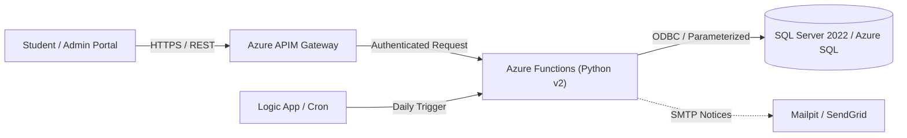

# Azure Student Fee Management System

[](https://learn.microsoft.com/en-us/azure/azure-functions/functions-reference-python)
[](https://learn.microsoft.com/en-us/azure/azure-sql/)
[](https://learn.microsoft.com/en-us/azure/api-management/)
[](https://github.com/axllent/mailpit)
[](https://pytest.org)

An enterprise-ready, serverless student fee management platform built with **Azure Functions (Python v2)**, **Azure SQL Database / SQL Server 2022**, **Azure API Management (APIM)**, and **Azure Logic Apps**.

The repository is pre-configured with a local simulation environment using **Docker Compose** (SQL Server 2022 + Mailpit) and synthetic dataset generation for up to 5,000+ student fee records.

---

## 1. Repository Structure

```text
.
├── .env.example               # Root environment variable template (No real secrets)
├── .gitignore                 # Excludes Python artifacts, secrets, .env, and local.settings.json
├── docker-compose.yml         # Local environment (SQL Server 2022 + Mailpit)
├── README.md                  # Main repository documentation
│
├── database/                  # Database definitions and migration scripts
│   ├── schema.sql             # Relational DDL (Students, Invoices, Payments, Triggers, Indexes)
│   ├── seed.sql               # Baseline development & QA seed data
│   └── seed_5000.sql          # Synthetic generation script for 5,000 students & invoices
│
├── functions/                 # Azure Functions Python v2 Microservice
│   ├── function_app.py        # Modern Python v2 routing entrypoint
│   ├── host.json              # Azure Functions host & extension configuration
│   ├── requirements.txt       # Production dependencies
│   ├── .funcignore            # Deployment ignore rules
│   ├── local.settings.json.example # Local settings template (placeholders only)
│   ├── shared/                # Core reusable microservice modules
│   │   ├── __init__.py        # Package exports
│   │   ├── db.py              # Parameterized SQL connection pooling & query helpers
│   │   ├── auth.py            # JWT / Entra ID token verification & RBAC
│   │   └── status.py          # Enums (InvoiceStatus, PaymentStatus) & HTTP response builders
│   └── tests/                 # Unit test suite
│       ├── __init__.py
│       ├── conftest.py        # Fixtures and environment mocks
│       ├── test_auth.py       # JWT verification & claims tests
│       ├── test_db.py         # Connection string formatting & query mock tests
│       └── test_status.py     # Status enums & JSON serialization tests
│
├── scripts/                   # Operations & automation utilities
│   └── send_reminders_local.py # Local fee reminder dispatcher via Mailpit SMTP
│
├── logicapp/                  # Azure Logic Apps integration
│   └── README.md              # Workflow architecture, recurrence triggers & connector specs
│
├── apim/                      # Azure API Management configuration
│   ├── README.md              # APIM deployment & policy import documentation
│   └── policies/              # Policy XML templates
│       ├── global-policy.xml  # Global CORS, rate limiting, and correlation IDs
│       ├── api-policy.xml     # Fee Management backend routing and header forwarding
│       └── jwt-validation-policy.xml # Entra ID Bearer token validation fragment
│
└── docs/                      # Architectural and operational guides
    ├── architecture.md        # Comprehensive architecture design and Mermaid diagrams
    ├── deployment-guide.md    # Local setup and Azure cloud deployment guide
    └── screenshots/           # Verification snapshots and UI screenshots
        ├── .gitkeep
        └── README.md
```

---

## 2. Architecture Highlights



- **Serverless Microservice:** Built using the Azure Functions Python v2 programming model with `@app.route()`.
- **Relational Integrity:** Includes computed persisted balance columns, indexed foreign keys, and an automated payment balance reconciliation trigger.
- **Strict Zero-Secrets Policy:** Real credentials and secret keys are never committed. All sensitive values are loaded strictly via environment variables.
- **Local Developer Experience:** Full offline development stack with Microsoft SQL Server 2022 container and Mailpit email inspector.

---

## 3. Quick Start (Local Setup)

### 3.1. Configure Environment Files
```bash
# 1. Copy root environment template
cp .env.example .env

# 2. Copy Azure Functions local settings template
cp functions/local.settings.json.example functions/local.settings.json
```

### 3.2. Start Local Containers
```bash
docker compose up -d
```
- **SQL Server 2022:** `localhost:1433`
- **Mailpit Web UI:** [http://localhost:8025](http://localhost:8025)

### 3.3. Initialize Database
Apply the SQL DDL and seed scripts using `sqlcmd` or Azure Data Studio:

```bash
# Schema
sqlcmd -S localhost,1433 -U sa -P "LocalDevSecret123!" -C -i database/schema.sql

# Baseline Seed
sqlcmd -S localhost,1433 -U sa -P "LocalDevSecret123!" -C -i database/seed.sql

# (Optional) 5,000 High-Volume Records
sqlcmd -S localhost,1433 -U sa -P "LocalDevSecret123!" -C -i database/seed_5000.sql
```

### 3.4. Install Dependencies & Run Tests
```bash
python -m venv .venv

# Activate virtual environment
# Windows (PowerShell):
.venv\Scripts\Activate.ps1
# Linux / macOS:
source .venv/bin/activate

pip install -r functions/requirements.txt

# Run unit tests
cd functions
pytest -v tests/
cd ..
```

### 3.5. Run Azure Functions Locally
Ensure [Azure Functions Core Tools v4](https://learn.microsoft.com/en-us/azure/azure-functions/functions-run-local) is installed:

```bash
cd functions
func start
```

Functions endpoints will be live at `http://localhost:7071/api/`.

### 3.6. Dispatch Local Fee Reminders
Test the automated notification workflow without external SMTP servers:

```bash
python scripts/send_reminders_local.py --days-ahead 7
```

View the generated HTML emails at [http://localhost:8025](http://localhost:8025).

---

## 4. API Reference Summary

| Method | Endpoint | Auth Required | Description |
| :--- | :--- | :--- | :--- |
| `GET` | `/api/health` | Anonymous | Health check and database connectivity probe |
| `GET` | `/api/students` | Bearer Token | List all students (supports `?status=` and `?course_id=`) |
| `GET` | `/api/students/{id}` | Bearer Token | Get student details and associated invoices |
| `GET` | `/api/invoices` | Bearer Token | List invoices (supports `?status=` and `?student_id=`) |
| `POST` | `/api/invoices` | Role: `BURSAR`, `ADMIN` | Create a new tuition fee invoice |
| `POST` | `/api/payments` | Bearer Token | Record student payment and reconcile balance |
| `POST` | `/api/reminders/trigger` | Role: `BURSAR`, `SYSTEM` | Fetch candidates for automated reminder emails |

---

## 5. Security & Environment Configuration Rules

- **Zero Hardcoded Secrets:** Connection strings, JWT secret keys, and API tokens must **never** be hardcoded in Python code, SQL scripts, or documentation.
- **Environment Ingestion:** In development, config is loaded from `.env` and `local.settings.json`. In Azure, configuration is mapped to **Application Settings** backed by **Azure Key Vault** references.
- **Least Privilege:** Cloud compute uses **System-Assigned Managed Identity** to access Azure SQL and Key Vault.

---

## 6. Documentation Index

- [Architecture Specification](docs/architecture.md)
- [Complete Deployment Guide (Local & Azure)](docs/deployment-guide.md)
- [Azure API Management (APIM) Policies](apim/README.md)
- [Logic App Reminders Workflow](logicapp/README.md)

