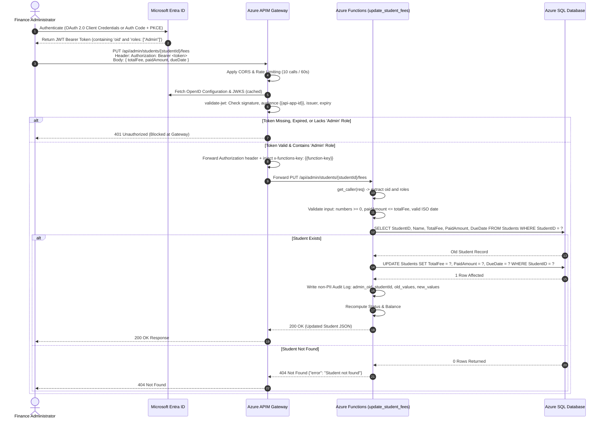
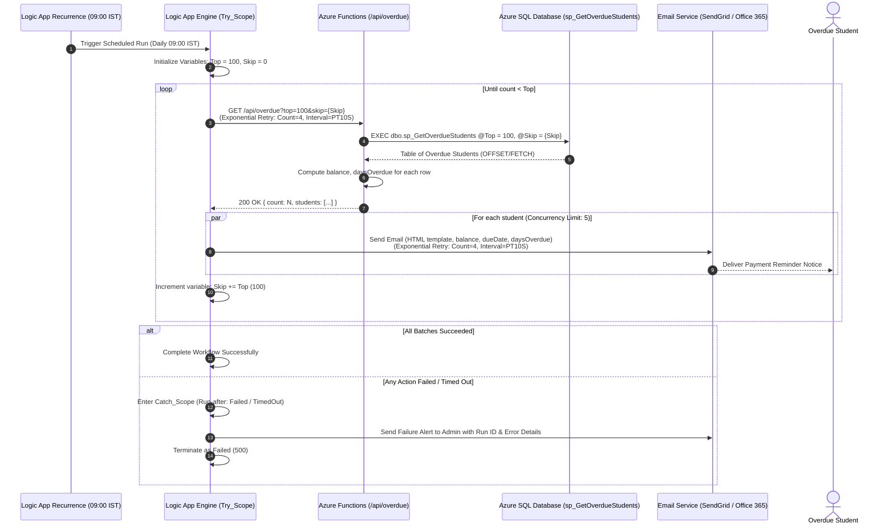
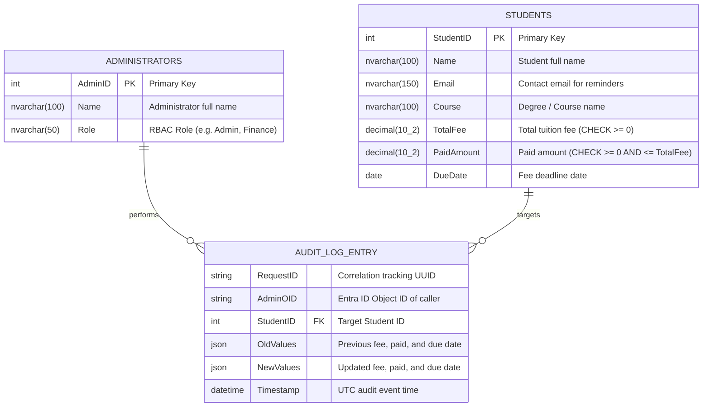

# Student Fee Management System - System Architecture Specification

---

## 1. Overview

The **Student Fee Management System** is a cloud-native, serverless enterprise platform developed for educational institutions to manage student fee structures, query payment statuses, process administrative fee updates, and execute automated daily reminder workflows for overdue accounts.

The architecture emphasizes:
- **Serverless Compute**: Azure Functions (Python v2 programming model) executing on a serverless Consumption plan.
- **Relational Integrity**: Azure SQL Database (and local SQL Server 2022) with check constraints, covering indexes, and stored-procedure-based pagination.
- **API Governance & Protection**: Azure API Management (APIM) enforcing rate limiting, CORS, Function key injection, and Microsoft Entra ID JWT validation.
- **Scheduled Orchestration**: Azure Logic Apps (Consumption) coordinating daily overdue scans, batch paging, and throttled email dispatches.
- **Enterprise Security & Observability**: Strict zero-PII structured logging, end-to-end request correlation (`x-ms-client-tracking-id`), exponential retry policies, and platform integration with Azure Application Insights.

---

## 2. High-Level Architecture Diagram

The system operates across client, gateway, serverless compute, data persistence, identity, and notification layers:

```mermaid
flowchart TB
    subgraph Clients["Client Layer"]
        SP["Student Portal / Mobile Client"]
        AP["Admin Dashboard / Bursar Client"]
    end

    subgraph Identity["Identity & Access Management"]
        Entra["Microsoft Entra ID<br/>(OAuth 2.0 / OpenID Connect)<br/>Issues Bearer JWT with 'roles'"]
    end

    subgraph Gateway["API Gateway Layer"]
        APIM["Azure API Management (APIM)<br/>• Rate Limiting (10 calls / 60s)<br/>• CORS for Localhost<br/>• Validate JWT & Roles claim<br/>• Function Key Injection via Named Values"]
    end

    subgraph Compute["Serverless Compute Layer"]
        AF["Azure Functions (Python v2 App)<br/>• GET /api/students/{id}/status<br/>• PUT /api/admin/students/{id}/fees<br/>• GET /api/overdue<br/>• GET /api/health<br/>• Tenacity Exponential DB Retries"]
    end

    subgraph Orchestration["Automated Orchestration"]
        LA["Azure Logic App (Consumption)<br/>• Daily Recurrence Trigger (09:00 IST)<br/>• Until Paging Loop (count &lt; Top)<br/>• For-Each (Concurrency: 5)<br/>• Try-Catch Scopes & Run-After Alerts"]
    end

    subgraph Data["Persistence Layer"]
        SQL[("Azure SQL Database / SQL Server 2022<br/>• Table: Students<br/>• Table: Administrators<br/>• Index: IX_Students_DueDate_Included<br/>• Stored Proc: sp_GetOverdueStudents")]
    end

    subgraph Notification["Notification Services"]
        Mail["Email Service<br/>(Office 365 Outlook / SendGrid / Mailpit)"]
    end

    subgraph Observability["Observability & Diagnostics"]
        AppInsights["Azure Application Insights<br/>• Structured Logs (duration_ms, studentId)<br/>• Correlation ID Tracking<br/>• Availability Health Probes"]
    end

    %% Client flows
    SP -->|1. GET /api/students/{id}/status| APIM
    AP -->|1a. Authenticate| Entra
    Entra -.->|1b. Return Bearer JWT| AP
    AP -->|2. PUT /api/admin/students/{id}/fees| APIM

    %% APIM flows
    APIM -->|Validate JWT against Entra JWKS| Entra
    APIM -->|Forward authenticated request with Function Key| AF

    %% Logic App flow
    LA -->|Poll overdue batches: GET /api/overdue| APIM
    LA -->|Dispatch templated emails| Mail

    %% Backend Compute flows
    AF -->|Parameterized T-SQL over TLS| SQL
    AF -.->|Structured Telemetry & Logs| AppInsights
```

---

## 3. Sequence Workflows

### 3.1. Student Fee Status Query

A public or authenticated client queries the fee status for a specific student.

```mermaid
sequenceDiagram
    autonumber
    actor Client as Student / Portal Client
    participant APIM as Azure APIM Gateway
    participant Func as Azure Functions (get_student_fee_status)
    participant DB as Azure SQL Database

    Client->>APIM: GET /api/students/{studentId}/status<br/>(Optional: x-ms-client-tracking-id)
    APIM->>APIM: Check CORS (localhost allow-list)
    APIM->>APIM: Rate Limit (10 calls / 60s per Subscription ID)
    APIM->>APIM: Inject x-functions-key: {{function-key}}
    APIM->>Func: Forward GET /api/students/{studentId}/status
    Func->>Func: Extract / Generate request_id
    Func->>Func: Validate studentId is integer (returns 400 if invalid)
    Func->>DB: SELECT StudentID, Name, TotalFee, PaidAmount, DueDate FROM Students WHERE StudentID = ?
    alt Student Found
        DB-->>Func: Row data returned
        Func->>Func: compute_status(total_fee, paid_amount, due_date, today)
        Func->>Func: Structured Log (operation, studentId, duration_ms)
        Func-->>APIM: 200 OK { studentId, name, totalFee, paidAmount, balance, dueDate, status }
        APIM-->>Client: 200 OK JSON response
    else Student Not Found
        DB-->>Func: No rows returned
        Func-->>APIM: 404 Not Found {"error": "Student ... not found"}
        APIM-->>Client: 404 Not Found
    else Database Error / Timeout
        DB-->>Func: Transient Connection Error
        Func->>Func: Tenacity retry (up to 3 attempts with exponential backoff)
        Func->>Func: Log stack trace (redacting credentials); return generic 500
        Func-->>APIM: 500 Internal Server Error {"error": "An internal error occurred..."}
        APIM-->>Client: 500 Internal Server Error
    end
```

---

### 3.2. Admin Fee Update with Microsoft Entra ID JWT Validation

An administrative user updates a student's total fee, paid amount, or due date.



---

### 3.3. Daily Scheduled Overdue Reminder Workflow

The Logic App executes on a scheduled timer, querying overdue records batch-by-batch and dispatching reminders.



---

## 4. Entity-Relationship (ER) Data Model

The persistence layer is modeled in Azure SQL / SQL Server with strict relational integrity, check constraints, and covering indexes:



### Table Specifications & Constraints

1. **`dbo.Students`**:
   - `StudentID INT NOT NULL PRIMARY KEY`
   - `Name NVARCHAR(100) NOT NULL`
   - `Email NVARCHAR(150) NOT NULL`
   - `Course NVARCHAR(100) NULL`
   - `TotalFee DECIMAL(10,2) NOT NULL`
   - `PaidAmount DECIMAL(10,2) NOT NULL DEFAULT (0)`
   - `DueDate DATE NOT NULL`
   - **Check Constraints**:
     - `CK_Students_TotalFee_Positive`: `TotalFee >= 0`
     - `CK_Students_PaidAmount_Positive`: `PaidAmount >= 0`
     - `CK_Students_PaidAmount_LTE_TotalFee`: `PaidAmount <= TotalFee`
   - **Covering Nonclustered Index**:
     ```sql
     CREATE NONCLUSTERED INDEX IX_Students_DueDate_Included
     ON dbo.Students (DueDate)
     INCLUDE (TotalFee, PaidAmount, Email, Name);
     ```

2. **`dbo.Administrators`**:
   - `AdminID INT NOT NULL PRIMARY KEY`
   - `Name NVARCHAR(100) NOT NULL`
   - `Role NVARCHAR(50) NOT NULL`

3. **`dbo.sp_GetOverdueStudents` Stored Procedure**:
   - Parameters: `@Top INT = 100`, `@Skip INT = 0`
   - Filters students where `DueDate < CAST(GETDATE() AS DATE) AND PaidAmount < TotalFee`.
   - Utilizes `ORDER BY DueDate OFFSET @Skip ROWS FETCH NEXT @Top ROWS ONLY`.

---

## 5. Security & Zero-Trust Architecture

1. **API Keys & Function Keys**:
   - Endpoints requiring authorization use Azure Functions `auth_level=FUNCTION`.
   - The master/host function key is stored exclusively as an APIM **Named Value** (`{{function-key}}`) marked as secret.
   - Public clients communicate solely through APIM; APIM injects the `x-functions-key` header upstream to the backend.

2. **JWT & Role-Based Access Control (RBAC)**:
   - Microsoft Entra ID validates callers using OpenID Connect discovery (`/.well-known/openid-configuration`).
   - APIM's `<validate-jwt>` policy rejects any request lacking an active token or the `roles: ["Admin"]` claim with `HTTP 401 Unauthorized`.
   - The Python backend executes defense-in-depth verification (`shared/auth.py`), extracting the caller's object ID (`oid`) for audit trails.

3. **Least Privilege Principles**:
   - Azure Functions connects to Azure SQL via dedicated credentials or System-Assigned Managed Identity.
   - Database accounts hold only `db_datareader`, `db_datawriter`, and `EXECUTE ON dbo.sp_GetOverdueStudents`. DDL privileges (`DROP`, `ALTER`) are disabled in runtime connections.

4. **Secrets Management**:
   - Zero hardcoded passwords, tokens, or connection strings exist in source code or Git.
   - In production, Azure Functions consumes connection strings through **Azure Key Vault References**:
     ```text
     SQL_CONNECTION_STRING=@Microsoft.KeyVault(SecretUri=https://<vault-name>.vault.azure.net/secrets/SqlConnectionString/<version>)
     ```

5. **SQL Firewall & Network Boundaries**:
   - Azure SQL Database enforces firewall rules restricting access exclusively to Azure service IPs and dedicated VNet NAT gateways.
   - Public internet traffic cannot establish direct connections to port 1433.

6. **Parameterized Queries (SQL Injection Prevention)**:
   - All database operations in `shared/db.py` (`execute_one`, `execute_query`, `execute_non_query`) utilize parameterized query tuples (`?` placeholders).
   - Raw string concatenation is completely banned.

---

## 6. Scalability & Performance Engineering

1. **Covering Index Optimization**:
   - The `IX_Students_DueDate_Included` nonclustered index covers the query in `sp_GetOverdueStudents`.
   - The index key is `(DueDate)` with `INCLUDE (TotalFee, PaidAmount, Email, Name)`. This eliminates expensive bookmark lookups and clustered index scans across large student tables.

2. **Pagination with T-SQL OFFSET / FETCH**:
   - Overdue queries use deterministic keyset ordering (`ORDER BY DueDate, StudentID`) with parameterized `OFFSET @Skip ROWS FETCH NEXT @Top ROWS ONLY`.
   - The `@Top` parameter is clamped to a maximum of 500 in the API layer to prevent memory exhaustion.
   - Tested and verified under 5,000+ synthetic student records generated via recursive CTEs.

3. **Consumption Plan Elasticity & Throttling**:
   - **Azure Functions**: Automatically scales out based on incoming HTTP trigger traffic.
   - **Azure Logic App**: Enforces **Concurrency Control = 5** on the `For each` notification loop to prevent hitting email provider SMTP rate limits (SendGrid / Office 365) while still processing large batches in parallel.

---

## 7. Monitoring, Retries & Resilience

1. **Structured Logging (Zero PII)**:
   - All log messages utilize Python's standard `logging` module and output key-value formatted telemetry:
     ```text
     request_id=<uuid> operation=update_student_fees studentId=42 duration_ms=28.4
     ```
   - Student emails, passwords, connection strings, and Bearer tokens are explicitly excluded and scrubbed.
   - Telemetry automatically flows to **Azure Application Insights** with `customDimensions` populated.

2. **Correlation Tracking**:
   - Incoming `x-ms-client-tracking-id` headers are captured and propagated across all logs and response headers. If missing, a UUID4 is generated.

3. **Multi-Tier Exponential Retries**:
   - **Database Connection Layer**: `shared/db.py` uses `tenacity` to retry transient ODBC connection failures (codes `08001`, `4060`, `ETIMEDOUT`) with exponential backoff (stop after 3 attempts).
   - **APIM & Logic App Layers**: Outgoing HTTP and email actions configure 4 exponential retry attempts spaced with `PT10S` base interval (`10s`, `20s`, `40s`, `80s`).

4. **Health Check Probe**:
   - Anonymous probe endpoint `GET /api/health` runs `SELECT 1` against the database.
   - Returns `200 OK` when healthy and `503 Service Unavailable` on database outage, allowing Azure Application Insights Availability Tests and Azure Monitor alerts to monitor service health.

---

## 8. Assumptions and Architectural Decisions

1. **Added `Email` Column in `Students` Table**:
   - **Decision**: Added `Email NVARCHAR(150) NOT NULL` to the `Students` table schema.
   - **Rationale**: Automated payment reminders cannot operate without a verified recipient address. Adding this directly to `Students` avoids joining a separate contact table for batch queries while keeping notification performance optimal.

2. **The "Pending" Status in Domain Logic**:
   - **Decision**: In `shared/status.py`, `compute_status()` introduces an explicit `"Pending"` status.
   - **Rationale**: Students with `PaidAmount == 0` whose `DueDate` is in the future should not be classified as "Overdue" or "Partially Paid". `"Pending"` accurately reflects an active invoice awaiting initial settlement prior to its deadline.

3. **Mock Authentication Exclusively for Local Testing**:
   - **Decision**: `shared/auth.py` defaults strictly to `AUTH_MODE=jwt`. Mock mode (`AUTH_MODE=mock`) requires explicit configuration via environment variable.
   - **Rationale**: Eliminates the risk of deploying development bypass headers (`X-Mock-Roles`, `X-Mock-Oid`) to staging or production. A loud startup warning is emitted whenever mock mode is activated.

4. **Future Improvement: `LastReminderSent` Tracking**:
   - **Recommendation**: In a future migration, add a `LastReminderSent DATETIME2 NULL` column to `dbo.Students` (or a dedicated `dbo.ReminderAudit` ledger).
   - **Value**: Prevents sending duplicate emails to the same student if the Logic App is re-run multiple times on the same day or if overlapping payment batches are processed.
