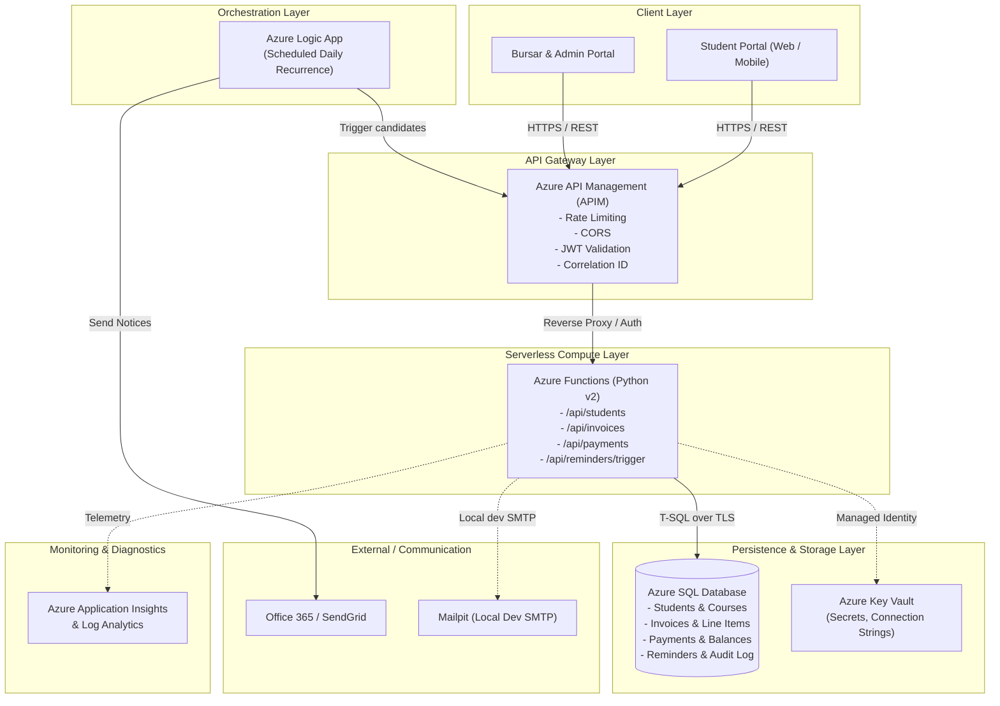
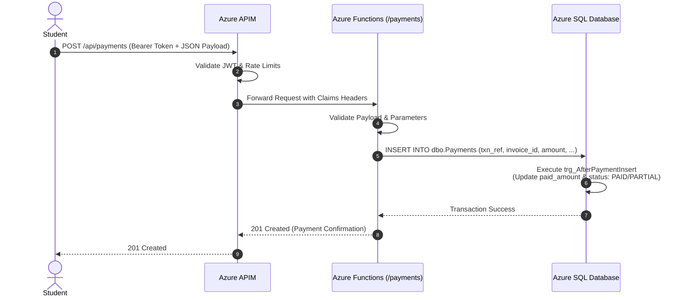
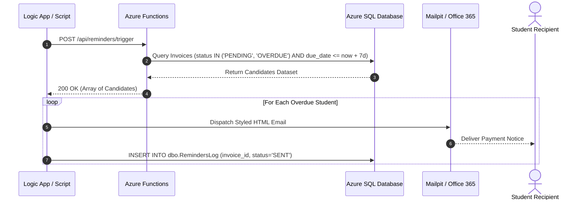

# Azure Student Fee Management System - Architecture Specification

---

## 1. Executive Summary

The **Azure Student Fee Management System** is a cloud-native, serverless enterprise platform designed to automate student fee invoicing, real-time payment reconciliation, academic accounting status tracking, and automated reminder workflows.

The system is built around **Azure Functions Python v2**, **Azure SQL Database**, **Azure API Management (APIM)**, and **Azure Logic Apps**, with a local developer environment powered by **Docker Compose** (Microsoft SQL Server 2022 + Mailpit).

---

## 2. High-Level System Architecture

---

## 3. Core Architectural Building Blocks

### 3.1. API Gateway (Azure API Management - APIM)
- **Role:** Single ingress point exposing the public REST API surface.
- **Policies:**
  - Token validation against Microsoft Entra ID (Azure AD).
  - Rate limiting (100 req/min per IP, 1000 req/min per subscription).
  - CORS enforcement allowing only authorized university portal domains.
  - Request tracking and correlation via `X-Correlation-Id`.

### 3.2. Serverless Compute (Azure Functions Python v2)
- **Runtime:** Python 3.10 / 3.11 with the modern Azure Functions v2 decorator model (`func.FunctionApp`).
- **Shared Architecture:**
  - `shared.db`: Robust connection pooling and parameterized query execution targeting SQL Server / Azure SQL.
  - `shared.auth`: Stateless JWT bearer token claims extraction and RBAC validation.
  - `shared.status`: Unified domain status enums (`InvoiceStatus`, `PaymentStatus`, etc.) and JSON response wrappers.
- **Endpoints:**
  - `GET /api/health`: Service & database heartbeat probe.
  - `GET /api/students`, `GET /api/students/{id}`: Student directory and invoice ledgers.
  - `GET /api/invoices`, `POST /api/invoices`: Fee invoice creation and retrieval.
  - `POST /api/payments`: Transaction ingestion with automatic balance recalculation.
  - `POST /api/reminders/trigger`: Batch query of candidate overdue accounts.

### 3.3. Database Layer (Azure SQL / SQL Server 2022)
- **Schema Design:**
  - Third normal form (3NF) relational model.
  - Computed persisted columns: `due_amount AS (total_amount - paid_amount) PERSISTED`.
  - Non-clustered indexing covering lookup patterns (`status`, `due_date`, `student_id`).
  - Database trigger `trg_AfterPaymentInsert` providing atomic updates to invoice status and paid balances upon payment insertion.
  - Synthetic test harness capable of generating 5,000+ realistic student records for query optimization.

### 3.4. Orchestration & Notifications (Azure Logic Apps)
- **Trigger:** Daily cron schedule (08:00 UTC).
- **Execution:** Calls the `/api/reminders/trigger` endpoint via APIM, parses delinquent or upcoming invoices, branches according to overdue severity, and dispatches templated emails.
- **Local Dev Simulation:** Script `scripts/send_reminders_local.py` replicates the Logic App workflow against local **Mailpit** without external cloud dependencies.

---

## 4. Sequence Workflows

### 4.1. Payment Ingestion and Automatic Reconciliation

### 4.2. Automated Fee Reminder Dispatch Workflow

---

## 5. Security & Zero-Trust Principles

1. **No Hardcoded Credentials:**
   All configuration is injected exclusively via environment variables (`AZURE_SQL_CONNECTIONSTRING`, `JWT_SECRET_KEY`, etc.).
2. **Managed Identities:**
   In Azure, Functions communicate with Azure SQL and Key Vault using system-assigned Managed Identity (passwordless authentication).
3. **Network Boundary Hardening:**
   - Functions exposed solely via APIM Gateway.
   - Azure SQL restricted via firewall rules and Virtual Network Private Endpoints.
4. **Data Protection:**
   - In-transit encryption: Mandatory TLS 1.2+ / TLS 1.3 across all HTTP and ODBC connections.
   - At-rest encryption: Transparent Data Encryption (TDE) enabled on Azure SQL Database.

