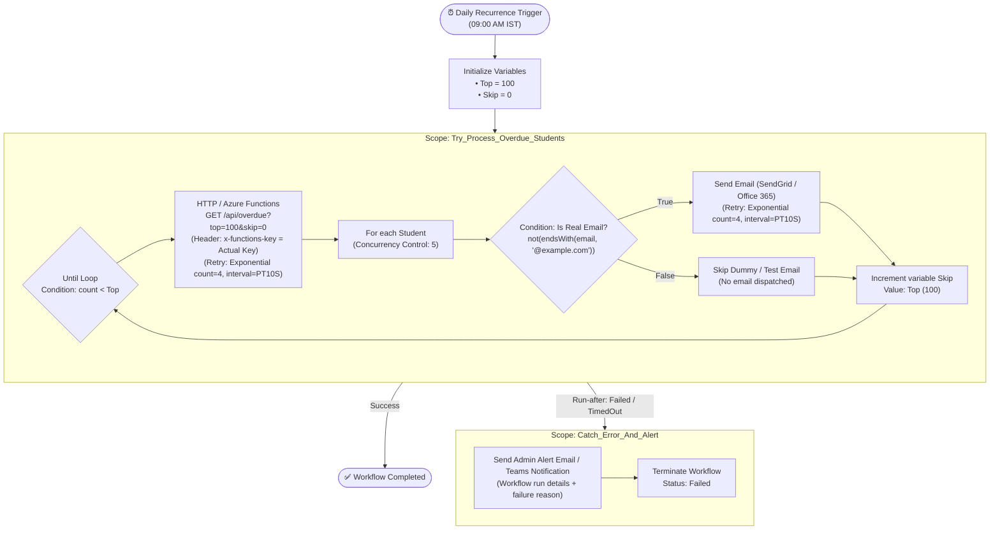

# Azure Logic App (Consumption) Design & Implementation Guide

This document describes the step-by-step portal design, configuration settings, retry policies, error-handling scopes, email safety filters, and email templates for the **Student Fee Overdue Reminders Logic App (Consumption)**.

---

## 1. Architecture & Workflow Overview

The Logic App executes on a scheduled daily trigger, polls the Azure Functions `/api/overdue` endpoint page-by-page, and dispatches reminder notifications to students. All operations are enclosed within a resilient `Try-Catch` scope hierarchy with exponential retries and throttled concurrency.



> [!IMPORTANT]
> **APIM Named Value Syntax Notice**:  
> The `{{function-key}}` mustache syntax is **specific to Azure API Management (APIM)** policy XML. In Azure Logic Apps, `{{...}}` will **not** be resolved. In Logic Apps, you must supply the **actual Function host key** directly, pass it via a workflow parameter (`@parameters('FunctionKey')`), or fetch it securely from Azure Key Vault.

---

## 2. Table of Every Setting & Configuration

The table below lists every trigger, variable, action, retry policy, concurrency setting, and run-after rule required when configuring the Logic App in the Azure Portal designer:

| Step / Action Name | Type / Connector | Key Parameters & Expressions | Retry Policy | Concurrency / Limits | Run After |
|---|---|---|---|---|---|
| **Recurrence_Daily_0900_IST** | Built-in: `Recurrence` | • Frequency: `Day`<br/>• Interval: `1`<br/>• Time zone: `India Standard Time`<br/>• Hours: `9`<br/>• Minutes: `0` | Default | None | *(Trigger)* |
| **Initialize_Variable_Top** | Built-in: `Initialize variable` | • Name: `Top`<br/>• Type: `Integer`<br/>• Value: `100` | None | None | Recurrence |
| **Initialize_Variable_Skip** | Built-in: `Initialize variable` | • Name: `Skip`<br/>• Type: `Integer`<br/>• Value: `0` | None | None | Initialize_Variable_Top |
| **Try_Scope** | Built-in: `Scope` | Container grouping the entire paging and dispatch loop | None | None | Initialize_Variable_Skip |
| **Until_All_Pages_Fetched** | Built-in: `Until` | Expression: `@less(body('HTTP_Get_Overdue_Students')?['count'], variables('Top'))`<br/>• Count limit: `60`<br/>• Timeout: `PT1H` | None | Sequential iterations | Inside Try_Scope |
| **HTTP_Get_Overdue_Students** | Built-in: `HTTP` *(or Azure Functions)* | • Method: `GET`<br/>• URI: `https://<function-app>.azurewebsites.net/api/overdue?top=@{variables('Top')}&skip=@{variables('Skip')}`<br/>• Headers:<br/>&nbsp;&nbsp;- `x-functions-key`: `<actual-function-host-key>` *(Do not use `{{...}}`)*<br/>&nbsp;&nbsp;- `x-ms-client-tracking-id`: `@{workflow().run.name}-@{variables('Skip')}` | **Exponential**<br/>• Count: `4`<br/>• Interval: `PT10S`<br/>• Min: `PT10S`<br/>• Max: `PT1H` | None | Inside Until loop |
| **For_each_Student** | Built-in: `For each` | • Select output from previous steps:<br/>`@body('HTTP_Get_Overdue_Students')?['students']` | None | **Concurrency Control:**<br/>• Status: `On`<br/>• Degree of Parallelism: `5` | HTTP_Get_Overdue_Students |
| **Condition_Filter_Example_Domain** | Built-in: `Condition` | Condition (Email Safety):<br/>`@not(endsWith(toLower(items('For_each_Student')?['email']), '@example.com'))`<br/>*(Skips placeholder test emails from seed data)* | None | None | Inside For_each_Student |
| **Send_Student_Email** | Connector:<br/>`Office 365 Outlook` *(Send an email (V2))*<br/>OR `SendGrid` *(Send email (V4))* | Inside **If True** branch:<br/>• To: `@{items('For_each_Student')?['email']}`<br/>• Subject: `Payment Reminder: Overdue Fee Balance - @{items('For_each_Student')?['name']}`<br/>• Body: *(See Template in Section 3)*<br/>• Importance: `Normal` | **Exponential**<br/>• Count: `4`<br/>• Interval: `PT10S`<br/>• Min: `PT10S`<br/>• Max: `PT1H` | Inherits loop concurrency (5) | Inside If True of Condition |
| **Increment_Skip** | Built-in: `Increment variable` | • Name: `Skip`<br/>• Value: `@variables('Top')` | None | None | After For_each_Student |
| **Catch_Scope** | Built-in: `Scope` | Error containment block for failure notifications | None | None | **Try_Scope**:<br/>☑️ `has failed`<br/>☑️ `has timed out`<br/>*(Uncheck `is successful`)* |
| **Send_Admin_Failure_Alert** | Connector:<br/>`Office 365 Outlook` / `SendGrid` | • To: `admin-alerts@yourdomain.edu`<br/>• Subject: `🚨 [ALERT] Fee Reminder Logic App Failed - Run ID @{workflow().run.name}`<br/>• Body: Details of failed actions, error message, and portal run URL | Default | None | Inside Catch_Scope |
| **Terminate_Workflow_Failed** | Built-in: `Terminate` | • Status: `Failed`<br/>• Code: `500`<br/>• Message: `Overdue reminder batch failed. Check execution logs in Catch_Scope.` | None | None | Send_Admin_Failure_Alert |

---

## 3. Email Template Text

Both the HTML email and Plain Text fallback templates include personalized student details, outstanding balance, due date, and overdue duration.

### HTML Email Template (Office 365 / SendGrid)

```html
<!DOCTYPE html>
<html>
<head>
  <meta charset="utf-8">
  <style>
    body { font-family: -apple-system, BlinkMacSystemFont, 'Segoe UI', Roboto, Helvetica, Arial, sans-serif; background-color: #f6f9fc; margin: 0; padding: 20px; color: #333333; }
    .container { max-width: 600px; margin: 0 auto; background-color: #ffffff; border-radius: 8px; overflow: hidden; box-shadow: 0 2px 8px rgba(0,0,0,0.06); border: 1px solid #e6ebf1; }
    .header { background-color: #004b87; padding: 24px 32px; color: #ffffff; text-align: left; }
    .header h2 { margin: 0; font-size: 20px; font-weight: 600; }
    .content { padding: 32px; }
    .greeting { font-size: 16px; margin-bottom: 16px; }
    .bill-box { background-color: #fff8f5; border-left: 4px solid #d9381e; padding: 16px 20px; margin: 24px 0; border-radius: 4px; }
    .bill-row { display: flex; justify-content: space-between; margin-bottom: 8px; font-size: 14px; }
    .bill-row:last-child { margin-bottom: 0; font-weight: 600; font-size: 15px; color: #d9381e; }
    .action-btn { display: inline-block; background-color: #004b87; color: #ffffff !important; text-decoration: none; padding: 12px 28px; border-radius: 4px; font-weight: 600; font-size: 14px; margin-top: 20px; }
    .footer { background-color: #f8fafc; padding: 20px 32px; font-size: 12px; color: #64748b; border-top: 1px solid #e2e8f0; text-align: center; }
  </style>
</head>
<body>
  <div class="container">
    <div class="header">
      <h2>Fee Payment Reminder</h2>
    </div>
    <div class="content">
      <p class="greeting">Dear <strong>@{items('For_each_Student')?['name']}</strong>,</p>
      <p>This is a reminder that your tuition and institutional fee payment for the current academic session is overdue.</p>
      
      <div class="bill-box">
        <div class="bill-row"><span>Student ID:</span><span>@{items('For_each_Student')?['studentId']}</span></div>
        <div class="bill-row"><span>Original Due Date:</span><span>@{items('For_each_Student')?['dueDate']}</span></div>
        <div class="bill-row"><span>Days Overdue:</span><span>@{items('For_each_Student')?['daysOverdue']} days</span></div>
        <hr style="border: none; border-top: 1px dashed #fed7aa; margin: 10px 0;">
        <div class="bill-row"><span>Total Outstanding Balance:</span><span>₹@{items('For_each_Student')?['balance']}</span></div>
      </div>

      <p>Please clear your pending balance at the earliest convenience to avoid any disruption to academic portal access or registration holds.</p>
      
      <center>
        <a href="https://portal.university.edu/student/payments" class="action-btn">Pay Fees Online</a>
      </center>
      
      <p style="margin-top: 28px; font-size: 13px; color: #6b7280;">If you have already processed this payment within the last 24 hours, kindly disregard this notice or share the transaction receipt with the finance office.</p>
    </div>
    <div class="footer">
      Office of the Bursar & Student Accounts | Email: finance@university.edu | Phone: +91 22 2576 0000
    </div>
  </div>
</body>
</html>
```

### Plain Text Version

```text
Subject: Payment Reminder: Overdue Fee Balance - @{items('For_each_Student')?['name']}

Dear @{items('For_each_Student')?['name']},

This is an automated reminder that your fee payment of ₹@{items('For_each_Student')?['balance']} was due on @{items('For_each_Student')?['dueDate']} and is currently @{items('For_each_Student')?['daysOverdue']} day(s) overdue.

Student ID: @{items('For_each_Student')?['studentId']}
Outstanding Balance: ₹@{items('For_each_Student')?['balance']}
Due Date: @{items('For_each_Student')?['dueDate']}

Please visit the Student Payment Portal to settle your balance:
https://portal.university.edu/student/payments

If you have already made this payment, please disregard this notice or contact the finance desk at finance@university.edu.

Sincerely,
Office of the Bursar & Student Accounts
```

---

## 4. Step-by-Step Portal Implementation Guide

### Step 1: Create the Logic App (Consumption)
1. Go to the **Azure Portal** (`https://portal.azure.com`).
2. Search for **Logic Apps** and click **+ Create**.
3. Select:
   - **Plan type**: `Consumption` (Multi-tenant).
   - **Subscription / Resource Group**: `rg-fee-management`.
   - **Logic App name**: `logic-fee-reminders-daily`.
   - **Region**: `Central India` (or matching region).
4. Click **Review + create** -> **Create**.

---

### Step 2: Configure Recurrence Trigger
1. In the Logic App Designer, select **Recurrence** trigger:
   - **Interval**: `1`
   - **Frequency**: `Day`
   - Click **Add new parameter** and select:
     - **Time zone**: `(UTC+05:30) Chennai, Kolkata, Mumbai, New Delhi`
     - **At these hours**: `9`
     - **At these minutes**: `0`

---

### Step 3: Initialize Pagination Variables
1. Under the trigger, add **Initialize variable**:
   - **Name**: `Top`
   - **Type**: `Integer`
   - **Value**: `100`
2. Add another **Initialize variable**:
   - **Name**: `Skip`
   - **Type**: `Integer`
   - **Value**: `0`

---

### Step 4: Add the Try Scope & Until Loop
1. Click **+ New step** -> search for **Scope** and name it `Try_Scope`.
2. Inside `Try_Scope`, add an **Until** control:
   - Rename to `Until_All_Pages_Fetched`.
   - Set condition to Advanced Mode:
     ```text
     @less(body('HTTP_Get_Overdue_Students')?['count'], variables('Top'))
     ```
   - In Until settings, confirm Limits:
     - **Count**: `60`
     - **Timeout**: `PT1H`

---

### Step 5: Configure the HTTP Action with Exponential Retry
1. Inside the Until loop, add an **HTTP** action:
   - **Action Name**: `HTTP_Get_Overdue_Students`
   - **Method**: `GET`
   - **URI**:
     ```text
     https://<your-functions-app>.azurewebsites.net/api/overdue?top=@{variables('Top')}&skip=@{variables('Skip')}
     ```
   - **Headers**:
     - `x-functions-key`: `<actual-function-host-key>`
       > [!WARNING]
       > Do **NOT** use `{{function-key}}` here. The `{{...}}` named-value syntax is exclusively resolved by Azure API Management. In Logic Apps, paste your actual Function host key (copied from Function App -> **App keys**) or retrieve it dynamically using an Azure Key Vault action / workflow parameter.
     - `x-ms-client-tracking-id`: `@{workflow().run.name}-@{variables('Skip')}`
2. Open **Settings** for `HTTP_Get_Overdue_Students`:
   - Under **Retry Policy**:
     - **Type**: `Exponential Interval`
     - **Count**: `4`
     - **Interval**: `PT10S`
     - **Minimum Interval**: `PT10S`
     - **Maximum Interval**: `PT1H`
   - Click **Done**.

---

### Step 6: Configure For Each with Concurrency = 5
1. Under the HTTP action, add a **For each** loop:
   - **Rename**: `For_each_Student`
   - **Select an output from previous steps**:
     ```text
     @body('HTTP_Get_Overdue_Students')?['students']
     ```
2. Click the `...` menu on `For_each_Student` -> **Settings**:
   - Turn **Concurrency Control** to **On**.
   - Set **Degree of Parallelism** slider to **`5`**.
   - Click **Done**.

---

### Step 7: Add Email Safety Condition & Send Email Action
To prevent accidental email bounces and spamming non-existent domains when running against test datasets (such as `seed.sql` and `seed_5000.sql`), filter out addresses ending in `@example.com`:

1. Inside `For_each_Student`, add a **Condition** control:
   - **Rename**: `Condition_Filter_Example_Domain`
   - In standard mode:
     - Left operand: `items('For_each_Student')?['email']`
     - Operator: `does not end with`
     - Right operand: `@example.com`
   - In advanced expression mode:
     ```text
     @not(endsWith(toLower(items('For_each_Student')?['email']), '@example.com'))
     ```

2. Under the **If True** branch:
   - Add **Send an email (V2)** (Office 365 Outlook) or **Send email (V4)** (SendGrid):
     - **Rename**: `Send_Student_Email`
     - **To**: `@{items('For_each_Student')?['email']}`
     - **Subject**: `Payment Reminder: Overdue Fee Balance - @{items('For_each_Student')?['name']}`
     - **Body**: Paste the HTML template from Section 3.
     - Click **Show advanced options** -> set **Is HTML**: `Yes`.
   - Click `...` on `Send_Student_Email` -> **Settings**:
     - Under **Retry Policy**:
       - **Type**: `Exponential Interval`
       - **Count**: `4`
       - **Interval**: `PT10S`
       - **Minimum Interval**: `PT10S`
     - Click **Done**.

3. Under the **If False** branch:
   - Leave empty (or add a **Compose** action: `Skipping test recipient: @{items('For_each_Student')?['email']}`). This ensures synthetic and sample student accounts are silently skipped.

---

### Step 8: Increment the Pagination Variable
1. Below `For_each_Student` (still inside the Until loop), add **Increment variable**:
   - **Name**: `Skip`
   - **Value**: `@variables('Top')`

---

### Step 9: Add the Catch Scope (Run-After Failure)
1. Collapse `Try_Scope`.
2. Below `Try_Scope`, click **+ New step** -> add a **Scope** named `Catch_Scope`.
3. Click the `...` menu on `Catch_Scope` -> **Configure run after**:
   - Check ☑️ **has failed**
   - Check ☑️ **has timed out**
   - Uncheck ⬜ **is successful**
   - Uncheck ⬜ **is skipped**
   - Click **Done**.
4. Inside `Catch_Scope`:
   - Add **Send an email (V2)** named `Send_Admin_Failure_Alert`:
     - **To**: `it-admin@university.edu`
     - **Subject**: `🚨 [ALERT] Fee Reminder Logic App Failed`
     - **Body**:
       ```text
       Logic App Run ID: @{workflow().run.name}
       Failed at: @{utcNow()}
       Error Scope Output: @{result('Try_Scope')}
       Please inspect run history in the Azure Portal.
       ```
   - Add **Terminate** action:
     - **Status**: `Failed`
     - **Code**: `500`
     - **Message**: `Batch reminder execution failed inside Try_Scope.`

---

## 5. Verification & Testing

1. **Trigger Manually**:
   - In the Azure Portal Logic App overview blade, click **Run Trigger** -> **Run**.
2. **Inspect Run History**:
   - Verify `Try_Scope` displays green checkmarks.
   - Inspect `HTTP_Get_Overdue_Students` input/output payloads to verify `top=100` and `skip=0` pagination.
   - Confirm `For_each_Student` processes batches in parallel with max 5 concurrent executions.
   - Verify that rows with `@example.com` emails take the **False** branch of `Condition_Filter_Example_Domain` and do not trigger outbound email dispatches.
3. **Verify Retry Behavior**:
   - If the backend returns a transient `503` or `429`, confirm the action attempts 4 retries spaced at exponential intervals (`10s`, `20s`, `40s`, `80s`).
4. **Verify Catch Branch**:
   - In a test run with an invalid Function key or broken backend, verify that `Try_Scope` fails, `Catch_Scope` activates, the admin alert is dispatched, and the run status terminates as `Failed`.
